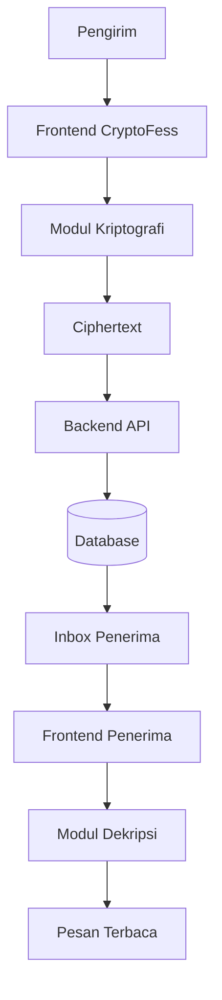

# PRODUCT REQUIREMENTS DOCUMENT (PRD)
# CryptoFess — Platform Pesan Anonim Berbasis Kriptografi

**Versi Dokumen:** 1.0  
**Status:** Draft untuk Pengembangan  
**Jenis Proyek:** Website berbasis web  
**Kategori:** Anonymous Messaging, Web Security, Cryptography  
**Algoritma Utama:** Diffie-Hellman dan ElGamal

---

## 1. Ringkasan Produk

### 1.1 Nama Produk

**CryptoFess**

### 1.2 Deskripsi Produk

CryptoFess adalah aplikasi web yang memungkinkan pengguna mengirim pesan kepada penerima tanpa menampilkan identitas pengirim kepada penerima. Pesan diproses menggunakan mekanisme kriptografi yang memanfaatkan algoritma Diffie-Hellman dan ElGamal sebagai bagian utama dari pembelajaran dan implementasi keamanan pesan.

Pengguna dapat membuat akun, membagikan tautan penerimaan pesan, menerima pesan anonim, serta membuka pesan melalui antarmuka web. Aplikasi juga menyediakan halaman Crypto Lab untuk mempelajari proses pembentukan kunci, enkripsi, dan dekripsi secara bertahap.

CryptoFess dikembangkan sebagai proyek pembelajaran yang menggabungkan pengembangan aplikasi web, pengelolaan basis data, dan implementasi algoritma kriptografi.

### 1.3 Visi Produk

Menyediakan platform pesan anonim berbasis web yang mudah digunakan sekaligus menjadi sarana pembelajaran implementasi algoritma kriptografi secara transparan.

### 1.4 Tujuan Utama

1. Memungkinkan pengiriman pesan tanpa menampilkan identitas pengirim kepada penerima.
2. Mengimplementasikan algoritma Diffie-Hellman dan ElGamal secara manual.
3. Meminimalkan penyimpanan informasi sensitif dalam bentuk plaintext.
4. Menyediakan antarmuka yang sederhana, responsif, dan mudah dipahami.
5. Memungkinkan pengguna mempelajari proses kriptografi melalui demonstrasi.
6. Menyediakan pengujian untuk memverifikasi kebenaran implementasi algoritma.

### 1.5 Definisi Istilah

| Istilah | Definisi |
|---|---|
| Pengirim | Pengguna yang mengirimkan pesan kepada penerima. |
| Penerima | Pengguna yang menerima dan membaca pesan. |
| Pesan anonim | Pesan yang tidak menampilkan identitas pengirim kepada penerima. |
| Plaintext | Pesan dalam bentuk teks asli sebelum dienkripsi. |
| Ciphertext | Data hasil proses enkripsi. |
| Public key | Kunci publik yang dapat dibagikan kepada pihak lain. |
| Private key | Kunci rahasia yang hanya boleh diketahui pemiliknya. |
| Diffie-Hellman (DH) | Algoritma pertukaran kunci untuk menghasilkan rahasia bersama. |
| ElGamal | Sistem kriptografi asimetris yang menggunakan pasangan kunci publik dan privat. |
| Enkripsi | Proses mengubah data asli menjadi bentuk yang tidak dapat dibaca langsung. |
| Dekripsi | Proses mengembalikan ciphertext menjadi data asli. |
| End-to-end encryption (E2EE) | Model ketika hanya endpoint yang berwenang yang dapat membaca pesan. |

---

## 2. Latar Belakang

Komunikasi melalui internet memungkinkan orang berbagi informasi dengan cepat. Namun, pengguna terkadang ingin mengirimkan pesan tanpa memperlihatkan identitasnya kepada penerima.

Platform pesan anonim dapat digunakan untuk memberikan masukan, menyampaikan pendapat, atau mengirim pesan pribadi tanpa mencantumkan nama pengirim. Akan tetapi, anonimitas identitas saja tidak cukup untuk menjamin kerahasiaan isi pesan.

Jika pesan disimpan atau dikirim sebagai teks biasa, pihak yang memiliki akses ke sistem atau basis data berpotensi membaca isinya. Oleh karena itu, diperlukan mekanisme perlindungan pesan yang menggunakan prinsip kriptografi.

CryptoFess dirancang untuk mempelajari penerapan dua algoritma:

- **Diffie-Hellman**, untuk mempelajari proses pembentukan rahasia bersama melalui pertukaran informasi publik.
- **ElGamal**, untuk mempelajari proses enkripsi dan dekripsi menggunakan pasangan kunci publik dan privat.

Kedua algoritma harus diimplementasikan secara manual sebagai bagian pembelajaran. Framework web, sistem basis data, dan pustaka untuk fungsi aplikasi lainnya tetap dapat digunakan sesuai ketentuan tugas.

**Catatan keamanan:** implementasi edukasional Diffie-Hellman dan ElGamal tidak otomatis menghasilkan sistem pesan yang aman untuk penggunaan produksi. Keamanan aktual bergantung pada desain protokol, pembangkitan bilangan acak, validasi parameter, autentikasi, integritas pesan, dan pengelolaan kunci.

---

## 3. Tujuan dan Indikator Keberhasilan

### 3.1 Tujuan Fungsional

- Pengguna dapat membuat akun dan masuk ke aplikasi.
- Pengguna dapat memperoleh tautan penerimaan pesan.
- Pengirim dapat mengirim pesan tanpa mengisi identitas pengirim.
- Pesan dapat disimpan dan ditampilkan kepada penerima yang benar.
- Proses enkripsi dan dekripsi dapat diperagakan melalui Crypto Lab.
- Pengguna dapat melihat status pesan, misalnya belum dibaca atau sudah dibaca.

### 3.2 Tujuan Teknis

- Mengimplementasikan operasi matematika pendukung kriptografi secara manual.
- Mengimplementasikan proses Diffie-Hellman dan ElGamal tanpa pustaka yang menggantikan algoritma utama.
- Memisahkan antarmuka, API, logika kriptografi, dan penyimpanan data.
- Menyediakan pengujian unit dan pengujian alur pesan.
- Memastikan plaintext tidak dikirim atau disimpan pada server dalam rancangan enkripsi sisi klien yang dipilih.

### 3.3 Indikator Keberhasilan

| ID | Indikator | Kriteria |
|---|---|---|
| KPI-01 | Registrasi | Pengguna dapat membuat akun dengan data valid. |
| KPI-02 | Autentikasi | Pengguna dapat masuk menggunakan kredensial yang benar. |
| KPI-03 | Pengiriman pesan | Pesan dapat dikirim ke penerima yang dituju. |
| KPI-04 | Kerahasiaan | Isi pesan tidak tersimpan sebagai plaintext di server. |
| KPI-05 | Diffie-Hellman | Dua pihak menghasilkan nilai rahasia bersama yang sama pada parameter uji. |
| KPI-06 | ElGamal | Pesan uji dapat dienkripsi dan didekripsi dengan benar. |
| KPI-07 | Validasi | Input dan parameter yang tidak valid ditolak. |
| KPI-08 | Antarmuka | Halaman utama dapat digunakan pada desktop dan perangkat seluler. |
| KPI-09 | Pengujian | Seluruh pengujian inti lulus pada lingkungan pengembangan. |
| KPI-10 | Dokumentasi | README menjelaskan instalasi, konfigurasi, penggunaan, dan batasan keamanan. |

---

## 4. Ruang Lingkup Produk

### 4.1 Fitur yang Termasuk

1. Halaman beranda.
2. Registrasi dan login.
3. Profil pengguna.
4. Pembuatan tautan penerimaan pesan.
5. Formulir pengiriman pesan anonim.
6. Inbox penerima.
7. Pembacaan dan dekripsi pesan.
8. Implementasi Diffie-Hellman manual.
9. Implementasi ElGamal manual.
10. Crypto Lab untuk demonstrasi algoritma.
11. Pengelolaan pesan.
12. Validasi input dan penanganan kesalahan.
13. Pengujian algoritma dan alur aplikasi.
14. Dokumentasi instalasi dan penggunaan.

### 4.2 Fitur yang Tidak Termasuk dalam Versi Pertama

- Aplikasi Android atau iOS native.
- Pengiriman pesan real-time.
- Lampiran gambar, audio, atau video.
- Panggilan suara atau video.
- Pengiriman pesan massal.
- Pembayaran atau fitur premium.
- Jaminan anonimitas terhadap seluruh pihak di jaringan.
- Sistem moderasi berbasis kecerdasan buatan.
- Penggunaan untuk komunikasi berisiko tinggi yang memerlukan audit keamanan profesional.

Fitur di luar ruang lingkup dapat dipertimbangkan pada versi selanjutnya.

---

## 5. Target Pengguna

### 5.1 Pengguna Utama

**Mahasiswa dan peserta pembelajaran teknologi**

Pengguna yang ingin mempelajari implementasi kriptografi dan pengembangan aplikasi web.

**Pengguna pesan anonim**

Pengguna yang ingin menerima pesan tanpa menampilkan identitas pengirim kepada penerima.

**Penguji atau dosen**

Pihak yang mengevaluasi fungsi aplikasi, ketepatan algoritma, struktur kode, dan dokumentasi.

### 5.2 Kebutuhan Pengguna

| Pengguna | Kebutuhan |
|---|---|
| Pengirim | Dapat mengirim pesan tanpa mengisi nama atau identitas. |
| Penerima | Dapat membagikan tautan dan membaca pesan yang ditujukan kepadanya. |
| Mahasiswa | Dapat melihat tahapan proses DH dan ElGamal. |
| Penguji | Dapat memverifikasi algoritma dan menguji alur aplikasi. |

---

## 6. Batasan dan Asumsi Teknis

### 6.1 Batasan Implementasi

- Aplikasi berjalan melalui browser.
- Frontend dan backend berkomunikasi melalui API.
- Basis data menyimpan informasi akun, metadata, dan ciphertext sesuai rancangan.
- Private key tidak boleh disimpan sebagai data biasa di server.
- Algoritma Diffie-Hellman dan ElGamal harus ditulis sendiri.
- JavaScript `BigInt` boleh digunakan untuk operasi bilangan bulat besar.
- Framework frontend, backend, dan koneksi basis data dapat digunakan apabila diperbolehkan oleh ketentuan tugas.
- Library yang menggantikan implementasi inti DH atau ElGamal tidak digunakan pada modul algoritma utama.

### 6.2 Prinsip Pengembangan

1. Memisahkan logika kriptografi dari komponen antarmuka.
2. Memisahkan pengelolaan akun dari pengelolaan pesan.
3. Menghindari penyimpanan plaintext pada server.
4. Menghindari pencatatan isi pesan dalam log.
5. Menyediakan validasi terhadap input pengguna.
6. Menyediakan pengujian untuk fungsi matematika dan kriptografi.
7. Mendokumentasikan batasan keamanan secara jelas.

### 6.3 Batasan Kriptografi

Diffie-Hellman digunakan untuk menghasilkan rahasia bersama, bukan untuk mengenkripsi pesan secara langsung. ElGamal digunakan untuk mengenkripsi nilai pada domain matematis tertentu dan tidak secara langsung dirancang untuk mengenkripsi teks panjang dalam bentuk arbitrer.

Karena itu, implementasi pesan teks memerlukan rancangan pengemasan data dan protokol yang sesuai. Jika proyek membutuhkan enkripsi simetris, fungsi derivasi kunci, atau mekanisme autentikasi ciphertext, pengguna harus memastikan terlebih dahulu apakah komponen tambahan tersebut diperbolehkan oleh instruksi tugas.

Untuk demo akademik, ukuran parameter dapat dibuat kecil pada contoh perhitungan agar mudah dipahami. Parameter kecil tersebut **tidak boleh dianggap aman untuk melindungi pesan nyata**.

---

## 7. Arsitektur Sistem

### 7.1 Komponen Utama

**Frontend**

Bertanggung jawab terhadap:

- Menampilkan halaman aplikasi.
- Menangani input pengguna.
- Menampilkan inbox dan detail pesan.
- Menjalankan proses kriptografi sisi klien sesuai protokol yang dipilih.
- Menampilkan hasil demonstrasi algoritma.

**Backend API**

Bertanggung jawab terhadap:

- Registrasi dan autentikasi pengguna.
- Pengelolaan profil dan tautan penerimaan pesan.
- Validasi permintaan.
- Penyimpanan ciphertext dan metadata pesan.
- Pengambilan daftar pesan milik penerima.
- Penghapusan pesan.
- Pembatasan akses dan pengendalian penyalahgunaan.

**Modul Kriptografi**

Berisi implementasi manual:

- Operasi modulo.
- Pangkat modular.
- Greatest Common Divisor (GCD).
- Extended Euclidean Algorithm.
- Diffie-Hellman.
- ElGamal.
- Fungsi konversi data yang dibutuhkan protokol.

**Database**

Menyimpan:

- Data akun.
- Hash kata sandi.
- Kunci publik.
- Ciphertext.
- Metadata kriptografi.
- Waktu pembuatan, pembacaan, dan penghapusan pesan.

### 7.2 Diagram Arsitektur



### 7.3 Alur Pengiriman Pesan

1. Pengirim membuka tautan penerima.
2. Frontend mengambil informasi publik yang diperlukan.
3. Pengirim memasukkan isi pesan.
4. Frontend memproses pesan menggunakan protokol kriptografi yang telah ditentukan.
5. Frontend mengirim ciphertext dan metadata ke backend.
6. Backend memvalidasi permintaan dan menyimpan data.
7. Penerima membuka inbox.
8. Penerima memilih pesan.
9. Proses dekripsi dilakukan di sisi klien sesuai protokol.
10. Pesan asli ditampilkan jika proses dekripsi berhasil.

### 7.4 Prinsip Penyimpanan

Server hanya boleh menerima data yang memang diperlukan untuk pengiriman dan penyimpanan pesan. Jika targetnya adalah enkripsi sisi klien, plaintext dan private key penerima tidak boleh dikirim ke backend.

Klaim tersebut harus diverifikasi melalui pengujian jaringan dan pemeriksaan penyimpanan database, bukan hanya berdasarkan tampilan aplikasi.

---

## 8. Rancangan Kriptografi

### 8.1 Diffie-Hellman

Diffie-Hellman digunakan untuk membentuk nilai rahasia bersama antara dua pihak melalui pertukaran nilai publik.

Misalnya:

- \(p\): bilangan prima yang dipilih.
- \(g\): generator yang sesuai.
- \(a\): private key pihak A.
- \(b\): private key pihak B.

Pihak A menghitung:

\[
A = g^a \bmod p
\]

Pihak B menghitung:

\[
B = g^b \bmod p
\]

Keduanya bertukar nilai publik, kemudian menghitung rahasia bersama:

\[
S_A = B^a \bmod p
\]

\[
S_B = A^b \bmod p
\]

Dalam kondisi parameter dan operasi yang benar:

\[
S_A = S_B
\]

#### Kebutuhan Implementasi

- Validasi parameter.
- Perhitungan pangkat modular.
- Pembangkitan private value.
- Perhitungan public value.
- Perhitungan shared secret.
- Pengujian bahwa kedua pihak menghasilkan rahasia yang sama.

**Catatan:** Diffie-Hellman biasa tidak mengautentikasi pihak lawan. Tanpa mekanisme autentikasi tambahan, sistem dapat rentan terhadap serangan man-in-the-middle.

### 8.2 ElGamal

ElGamal adalah algoritma kriptografi asimetris yang menggunakan pasangan kunci publik dan privat.

Parameter dasar:

- \(p\): bilangan prima.
- \(g\): generator yang sesuai.
- \(x\): private key.
- \(y\): public key.

Pembentukan public key:

\[
y = g^x \bmod p
\]

Untuk nilai pesan \(m\) yang memenuhi batas domain algoritma, pengirim memilih nilai acak \(k\), lalu menghitung:

\[
c_1 = g^k \bmod p
\]

\[
c_2 = m \cdot y^k \bmod p
\]

Ciphertext berupa pasangan:

\[
C = (c_1,c_2)
\]

Penerima menggunakan private key \(x\) untuk memulihkan pesan dengan menghitung invers modular dari faktor yang sesuai.

#### Kebutuhan Implementasi

- Pembentukan pasangan kunci.
- Validasi parameter dan domain pesan.
- Pemilihan nilai acak yang valid.
- Enkripsi.
- Dekripsi.
- Penanganan ciphertext yang tidak valid.
- Pengujian round-trip untuk data yang didukung.

#### Batasan

Rumus ElGamal dasar bekerja pada elemen domain matematis, bukan sembarang teks panjang secara langsung. Oleh karena itu, konversi pesan ke nilai yang valid atau rancangan protokol pembungkus diperlukan. Pengemasan teks tidak boleh mengabaikan batas domain atau menyebabkan data kehilangan informasi.

### 8.3 Hubungan Diffie-Hellman dan ElGamal

Kedua algoritma memiliki fungsi yang berbeda:

| Algoritma | Fungsi |
|---|---|
| Diffie-Hellman | Menghasilkan rahasia bersama melalui pertukaran nilai publik. |
| ElGamal | Mengenkripsi dan mendekripsi nilai pesan menggunakan pasangan kunci. |

Keduanya tidak boleh digabungkan secara sembarangan hanya untuk menyatakan bahwa aplikasi sudah aman. Protokol akhir harus menentukan secara eksplisit bagaimana kunci dibentuk, bagaimana pesan direpresentasikan, bagaimana ciphertext diverifikasi, dan bagaimana kegagalan dekripsi ditangani.

Jika tugas mewajibkan kedua algoritma muncul dalam satu alur, dokumentasikan peran masing-masing secara jelas. Jangan mengklaim integrasi E2EE yang aman sebelum desain protokol dan implementasinya ditinjau.

### 8.4 Operasi Matematika Pendukung

Modul matematika minimal meliputi:

- `modPow(base, exponent, modulus)`
- `gcd(a, b)`
- `extendedGcd(a, b)`
- `modInverse(a, modulus)`
- Validasi parameter dan rentang nilai.

Seluruh operasi harus diuji secara terpisah sebelum digunakan oleh modul DH dan ElGamal.

### 8.5 Pembangkitan Bilangan Acak

Nilai privat dan nilai acak kriptografi tidak boleh dihasilkan menggunakan `Math.random()`.

Untuk implementasi demonstrasi, mekanisme pemilihan nilai dapat dibuat sederhana dan dijelaskan sebagai simulasi. Untuk perlindungan nyata, pembangkitan bilangan acak harus menggunakan sumber acak kriptografis yang sesuai.

Apabila ketentuan tugas melarang library kriptografi secara luas, batas larangan tersebut harus diklarifikasi terlebih dahulu. Implementasi manual algoritma tidak berarti seluruh kebutuhan keamanan produksi dapat digantikan oleh kode matematika sederhana.

### 8.6 Kebijakan Kunci

- Private key tidak boleh ditampilkan di halaman publik.
- Private key tidak boleh dimasukkan ke log.
- Private key tidak boleh dikirim ke backend pada model enkripsi sisi klien.
- Kunci publik dapat dibagikan sesuai protokol.
- Perubahan kunci harus mempertimbangkan akses terhadap pesan lama.
- Kehilangan private key dapat menyebabkan pesan lama tidak bisa didekripsi.

---

## 9. Kebutuhan Fungsional

### FR-01 — Halaman Beranda

Sistem menyediakan halaman utama yang berisi:

- Nama dan deskripsi CryptoFess.
- Penjelasan singkat tentang pesan anonim.
- Tombol masuk dan daftar.
- Tombol menuju Crypto Lab.
- Panduan singkat penggunaan.

**Kriteria penerimaan:**

- Halaman dapat dibuka tanpa login.
- Navigasi berfungsi.
- Tampilan menyesuaikan ukuran layar.

### FR-02 — Registrasi Pengguna

Pengguna dapat membuat akun menggunakan data yang ditentukan, misalnya username dan kata sandi.

**Kriteria penerimaan:**

- Username wajib diisi.
- Username tidak boleh duplikat.
- Kata sandi harus memenuhi kebijakan minimum.
- Kata sandi disimpan dalam bentuk hash yang sesuai.
- Kesalahan ditampilkan tanpa membocorkan informasi sensitif.

### FR-03 — Login

Pengguna dapat masuk ke akun yang telah terdaftar.

**Kriteria penerimaan:**

- Kredensial valid menghasilkan sesi yang sah.
- Kredensial tidak valid ditolak.
- Halaman terlindungi tidak dapat diakses tanpa autentikasi.
- Sesi dapat berakhir atau diakhiri dengan logout.

### FR-04 — Tautan Penerimaan Pesan

Setiap pengguna memperoleh tautan unik untuk menerima pesan.

Contoh format:

`https://domain.example/fess/username`

**Kriteria penerimaan:**

- Tautan mengarah ke penerima yang benar.
- Tautan tidak mengungkap private key.
- Pengguna dapat menyalin tautan.
- Tautan penerima tidak boleh dapat digunakan untuk membaca inbox secara langsung.

### FR-05 — Pengiriman Pesan Anonim

Pengirim dapat menulis dan mengirim pesan melalui halaman penerima.

**Kriteria penerimaan:**

- Identitas pengirim tidak ditampilkan kepada penerima.
- Pesan wajib memenuhi batas panjang.
- Input divalidasi.
- Pesan diproses sesuai protokol kriptografi.
- Sistem menampilkan konfirmasi jika pengiriman berhasil.
- Kegagalan pengiriman tidak menyebabkan pesan setengah tersimpan.

### FR-06 — Penyimpanan Pesan

Backend menerima ciphertext dan metadata yang dibutuhkan untuk menyimpan pesan.

**Kriteria penerimaan:**

- Pesan dikaitkan dengan penerima yang benar.
- Isi pesan tidak disimpan sebagai plaintext pada model enkripsi sisi klien.
- Data metadata divalidasi.
- Kesalahan database ditangani dengan aman.
- Log tidak berisi plaintext atau private key.

### FR-07 — Inbox Penerima

Penerima dapat melihat daftar pesan miliknya.

**Kriteria penerimaan:**

- Inbox memuat pesan milik pengguna yang sedang login.
- Pesan menampilkan waktu dan status.
- Isi plaintext tidak ditampilkan sebelum proses dekripsi yang diperlukan.
- Pengguna tidak dapat membaca inbox milik akun lain.

### FR-08 — Membaca Pesan

Penerima memilih pesan untuk membukanya.

**Kriteria penerimaan:**

- Sistem mengambil ciphertext dan metadata yang benar.
- Proses dekripsi dijalankan menggunakan kunci yang sesuai.
- Pesan asli ditampilkan hanya jika dekripsi berhasil.
- Kegagalan dekripsi menampilkan pesan yang jelas.
- Status baca diperbarui sesuai kebijakan aplikasi.

### FR-09 — Crypto Lab

Crypto Lab menyediakan demonstrasi proses Diffie-Hellman dan ElGamal.

Fitur minimal:

- Input parameter demo.
- Tombol menjalankan simulasi.
- Tampilan langkah perhitungan.
- Tampilan public key dan private value untuk lingkungan demo.
- Tampilan shared secret.
- Tampilan ciphertext.
- Tampilan hasil dekripsi.
- Penjelasan rumus yang digunakan.

**Kriteria penerimaan:**

- Hasil perhitungan sesuai implementasi modul.
- Input yang tidak valid ditolak.
- Private value demo diberi label jelas sebagai data simulasi.
- Crypto Lab tidak membocorkan private key pengguna sebenarnya.

### FR-10 — Penghapusan Pesan

Penerima dapat menghapus pesan dari inbox.

**Kriteria penerimaan:**

- Pengguna hanya dapat menghapus pesan yang menjadi haknya.
- Sistem meminta konfirmasi jika diperlukan.
- Pesan tidak lagi tampil setelah dihapus.
- Kebijakan penghapusan data pada database dijelaskan.

### FR-11 — Penanganan Kesalahan

Sistem menangani kesalahan jaringan, validasi, autentikasi, database, dan kriptografi.

**Kriteria penerimaan:**

- Kesalahan ditampilkan dalam bahasa yang mudah dipahami.
- Detail internal server tidak ditampilkan kepada pengguna.
- Sistem tidak mengembalikan plaintext sebagai fallback ketika dekripsi gagal.
- Kesalahan tidak menyebabkan kebocoran kunci atau isi pesan.

---

## 10. Kebutuhan Nonfungsional

### 10.1 Keamanan

- Seluruh koneksi produksi harus menggunakan HTTPS.
- Kata sandi harus disimpan menggunakan mekanisme hashing kata sandi yang sesuai.
- Endpoint terlindungi harus memverifikasi autentikasi dan otorisasi.
- Input harus divalidasi pada server.
- Aplikasi harus menerapkan perlindungan terhadap XSS, SQL injection, CSRF, dan penyalahgunaan endpoint sesuai arsitektur.
- Rate limiting diterapkan pada endpoint yang rentan disalahgunakan.
- Private key dan plaintext tidak boleh dimasukkan ke log.
- Ciphertext dan metadata harus divalidasi sebelum disimpan atau diproses.

### 10.2 Kinerja

Target awal untuk pengujian pada lingkungan pengembangan:

- Navigasi halaman utama terasa responsif.
- Permintaan API normal ditargetkan selesai dalam waktu kurang dari satu detik pada kondisi uji yang ditentukan, di luar proses kriptografi yang bergantung pada parameter.
- Operasi matematika menggunakan algoritma yang efisien, misalnya pangkat modular dengan metode square-and-multiply.
- Daftar inbox tidak memuat seluruh pesan sekaligus jika jumlahnya besar.

Target tersebut merupakan sasaran pengujian, bukan jaminan kinerja pada semua perangkat dan jaringan.

### 10.3 Usability

- Antarmuka mudah dipahami oleh pengguna baru.
- Pesan kesalahan menggunakan bahasa yang jelas.
- Formulir mempunyai label dan petunjuk yang memadai.
- Status loading, berhasil, dan gagal ditampilkan.
- Pengguna dapat menyalin tautan penerimaan pesan dengan mudah.

### 10.4 Kompatibilitas

Aplikasi ditargetkan dapat digunakan pada browser modern, seperti:

- Google Chrome.
- Microsoft Edge.
- Mozilla Firefox.

Pengujian dilakukan pada desktop dan perangkat seluler.

### 10.5 Maintainability

- Modul kriptografi dipisahkan dari antarmuka.
- Setiap algoritma mempunyai pengujian tersendiri.
- Fungsi mempunyai nama dan tanggung jawab yang jelas.
- Konfigurasi rahasia tidak ditulis langsung di source code.
- Dokumentasi instalasi dan konfigurasi disediakan.

---

## 11. Rancangan Antarmuka Pengguna (UI)

### 11.1 Halaman Beranda

Komponen:

- Logo dan nama CryptoFess.
- Navigasi.
- Hero section.
- Deskripsi singkat produk.
- Tombol “Mulai Sekarang”.
- Tombol “Pelajari Kriptografi”.
- Bagian cara kerja.
- Footer.

### 11.2 Halaman Registrasi

Komponen:

- Username.
- Kata sandi.
- Konfirmasi kata sandi jika dibutuhkan.
- Tombol daftar.
- Tautan menuju login.
- Pesan validasi.

### 11.3 Halaman Login

Komponen:

- Username.
- Kata sandi.
- Tombol login.
- Tautan menuju registrasi.
- Pesan kesalahan autentikasi.

### 11.4 Dashboard

Komponen:

- Ringkasan akun.
- Tautan penerimaan pesan.
- Tombol salin tautan.
- Jumlah pesan masuk.
- Daftar pesan terbaru.
- Navigasi ke inbox dan Crypto Lab.

### 11.5 Halaman Kirim Pesan

Komponen:

- Nama atau username penerima.
- Kolom isi pesan.
- Indikator batas karakter.
- Tombol kirim.
- Informasi bahwa identitas pengirim tidak ditampilkan kepada penerima.
- Status berhasil atau gagal.

### 11.6 Halaman Inbox

Komponen:

- Daftar pesan.
- Waktu pesan diterima.
- Status pesan.
- Tombol buka pesan.
- Tombol hapus.
- Empty state ketika belum ada pesan.

### 11.7 Halaman Baca Pesan

Komponen:

- Waktu pesan.
- Status dekripsi.
- Isi pesan setelah dekripsi berhasil.
- Tombol kembali ke inbox.
- Tombol hapus pesan.

### 11.8 Halaman Crypto Lab

Komponen:

- Tab Diffie-Hellman.
- Tab ElGamal.
- Input parameter.
- Tombol jalankan.
- Langkah perhitungan.
- Hasil perhitungan.
- Penjelasan matematis.
- Peringatan bahwa parameter demo bukan untuk komunikasi nyata.

### 11.9 Prinsip Desain

- Tampilan konsisten.
- Layout responsif.
- Kontras teks memadai.
- Tombol memiliki label yang jelas.
- Formulir memiliki indikator validasi.
- Informasi kriptografi ditampilkan secara bertahap agar mudah dipahami.

---

## 12. Rancangan API

Rancangan berikut merupakan usulan awal dan perlu disesuaikan dengan teknologi serta model autentikasi yang dipilih.

| Method | Endpoint | Fungsi |
|---|---|---|
| GET | `/api/health` | Memeriksa status backend. |
| POST | `/api/auth/register` | Membuat akun. |
| POST | `/api/auth/login` | Melakukan login. |
| POST | `/api/auth/logout` | Mengakhiri sesi. |
| GET | `/api/users/me` | Mengambil profil pengguna aktif. |
| GET | `/api/recipients/:username` | Mengambil informasi publik penerima. |
| GET | `/api/recipients/:username/public-keys` | Mengambil kunci publik penerima. |
| POST | `/api/messages` | Mengirim ciphertext ke penerima. |
| GET | `/api/messages/inbox` | Mengambil daftar pesan pengguna aktif. |
| GET | `/api/messages/:id` | Mengambil satu pesan yang berhak diakses. |
| PATCH | `/api/messages/:id/read` | Memperbarui status baca. |
| DELETE | `/api/messages/:id` | Menghapus pesan milik pengguna aktif. |

### 12.1 Contoh Permintaan Pengiriman Pesan

Contoh konseptual:

```json
{
  "recipientId": "recipient-id",
  "ciphertext": "serialized-ciphertext",
  "cryptoMetadata": {
    "algorithmVersion": "demo-v1",
    "ephemeralPublicValue": "public-value"
  }
}
```

Struktur sebenarnya harus mengikuti protokol kriptografi final. Contoh ini bukan format ciphertext standar dan tidak boleh digunakan tanpa penyesuaian.

### 12.2 Ketentuan API

- API tidak menerima private key pengguna.
- API tidak menerima plaintext jika protokol menetapkan enkripsi di sisi klien.
- Backend harus memvalidasi tipe data dan ukuran input.
- Backend memverifikasi kepemilikan pesan sebelum menampilkan, memperbarui, atau menghapusnya.
- Respons tidak boleh mengandung informasi internal yang sensitif.

---

## 13. Rancangan Basis Data

### 13.1 Tabel `users`

Menyimpan informasi akun.

| Kolom | Tipe Konseptual | Keterangan |
|---|---|---|
| id | UUID atau integer | Primary key. |
| username | VARCHAR | Username unik. |
| password_hash | VARCHAR | Hash kata sandi. |
| created_at | TIMESTAMP | Waktu pembuatan akun. |
| updated_at | TIMESTAMP | Waktu perubahan data. |

### 13.2 Tabel `public_keys`

Menyimpan informasi kunci publik.

| Kolom | Tipe Konseptual | Keterangan |
|---|---|---|
| id | UUID atau integer | Primary key. |
| user_id | UUID atau integer | Referensi ke pemilik akun. |
| algorithm | VARCHAR | Identitas algoritma. |
| public_key_data | TEXT atau JSON | Data kunci publik sesuai format protokol. |
| key_version | INTEGER | Versi kunci. |
| created_at | TIMESTAMP | Waktu pembuatan. |

Private key tidak boleh dimasukkan ke tabel ini.

### 13.3 Tabel `messages`

Menyimpan pesan terenkripsi.

| Kolom | Tipe Konseptual | Keterangan |
|---|---|---|
| id | UUID atau integer | Primary key. |
| recipient_id | UUID atau integer | ID penerima. |
| ciphertext | TEXT atau BLOB | Data terenkripsi. |
| crypto_metadata | JSON atau TEXT | Metadata yang diperlukan untuk dekripsi. |
| created_at | TIMESTAMP | Waktu pesan diterima server. |
| read_at | TIMESTAMP nullable | Waktu pesan dibaca. |
| deleted_at | TIMESTAMP nullable | Waktu penghapusan logis jika digunakan. |

Struktur metadata final perlu ditentukan berdasarkan protokol. Kolom untuk nonce, salt, tag autentikasi, atau parameter lain hanya ditambahkan jika memang dibutuhkan oleh skema enkripsi yang dipilih.

### 13.4 Relasi Data

- Satu pengguna dapat memiliki banyak pesan masuk.
- Satu pengguna dapat mempunyai lebih dari satu versi kunci publik.
- Setiap pesan mempunyai satu penerima.
- Metadata pesan terikat pada pesan terkait.

### 13.5 Kebijakan Data

- Password disimpan sebagai hash.
- Private key tidak disimpan sebagai plaintext di server.
- Plaintext pesan tidak disimpan oleh backend dalam model enkripsi sisi klien.
- Penghapusan pesan mengikuti kebijakan retensi yang ditetapkan.
- Log aplikasi tidak boleh merekam isi pesan.

---

## 14. Struktur Folder yang Disarankan

Contoh struktur berikut dapat disesuaikan dengan framework yang digunakan.

```text
cryptofess/
├── frontend/
│   ├── public/
│   └── src/
│       ├── components/
│       ├── pages/
│       │   ├── Home.jsx
│       │   ├── Login.jsx
│       │   ├── Register.jsx
│       │   ├── Dashboard.jsx
│       │   ├── Inbox.jsx
│       │   ├── ReadMessage.jsx
│       │   └── CryptoLab.jsx
│       ├── services/
│       │   └── api.js
│       ├── styles/
│       ├── App.jsx
│       └── main.jsx
│
├── backend/
│   └── src/
│       ├── routes/
│       ├── controllers/
│       ├── services/
│       ├── middleware/
│       ├── models/
│       └── app.js
│
├── crypto/
│   ├── math.js
│   ├── diffieHellman.js
│   ├── elgamal.js
│   ├── encoding.js
│   └── index.js
│
├── database/
│   └── schema.sql
│
├── tests/
│   ├── math.test.js
│   ├── diffieHellman.test.js
│   ├── elgamal.test.js
│   └── message-flow.test.js
│
├── .env.example
├── .gitignore
├── README.md
└── PRD_CryptoFess.md
```

### Ketentuan Struktur

- `frontend/` berisi tampilan dan interaksi pengguna.
- `backend/` berisi API dan logika aplikasi server.
- `crypto/` berisi implementasi algoritma utama.
- `database/` berisi skema dan perubahan struktur basis data.
- `tests/` berisi pengujian.
- `.env.example` berisi contoh konfigurasi tanpa rahasia aktif.
- `README.md` menjelaskan instalasi dan penggunaan.
- `PRD_CryptoFess.md` berisi dokumen kebutuhan produk.

---

## 15. Rencana Pengujian

### 15.1 Pengujian Matematika

| ID | Pengujian | Hasil yang Diharapkan |
|---|---|---|
| TEST-MATH-01 | Pangkat modular | Hasil sesuai perhitungan acuan. |
| TEST-MATH-02 | GCD | Menghasilkan faktor persekutuan terbesar yang benar. |
| TEST-MATH-03 | Extended GCD | Menghasilkan koefisien yang memenuhi identitas Bézout. |
| TEST-MATH-04 | Invers modular | Menghasilkan invers yang valid jika tersedia. |
| TEST-MATH-05 | Parameter tidak valid | Fungsi menolak nilai yang tidak sesuai. |

### 15.2 Pengujian Diffie-Hellman

| ID | Pengujian | Hasil yang Diharapkan |
|---|---|---|
| TEST-DH-01 | Pembentukan public value | Nilai sesuai rumus. |
| TEST-DH-02 | Perhitungan rahasia pihak A | Berhasil. |
| TEST-DH-03 | Perhitungan rahasia pihak B | Berhasil. |
| TEST-DH-04 | Perbandingan shared secret | Kedua pihak memperoleh nilai yang sama. |
| TEST-DH-05 | Parameter invalid | Proses ditolak. |

### 15.3 Pengujian ElGamal

| ID | Pengujian | Hasil yang Diharapkan |
|---|---|---|
| TEST-ELG-01 | Pembentukan pasangan kunci | Public key sesuai private key dan parameter. |
| TEST-ELG-02 | Enkripsi nilai valid | Ciphertext dihasilkan. |
| TEST-ELG-03 | Dekripsi ciphertext | Nilai asli berhasil dipulihkan. |
| TEST-ELG-04 | Domain pesan invalid | Input ditolak. |
| TEST-ELG-05 | Ciphertext invalid | Sistem menangani kesalahan tanpa crash. |

### 15.4 Pengujian Fungsional

| ID | Pengujian | Hasil yang Diharapkan |
|---|---|---|
| TEST-APP-01 | Registrasi valid | Akun berhasil dibuat. |
| TEST-APP-02 | Username duplikat | Registrasi ditolak. |
| TEST-APP-03 | Login valid | Pengguna masuk. |
| TEST-APP-04 | Login invalid | Login ditolak. |
| TEST-APP-05 | Pengiriman pesan | Pesan masuk ke penerima yang benar. |
| TEST-APP-06 | Inbox | Hanya pesan milik penerima yang tampil. |
| TEST-APP-07 | Membaca pesan | Pesan dapat didekripsi jika kunci sesuai. |
| TEST-APP-08 | Mengakses pesan akun lain | Akses ditolak. |
| TEST-APP-09 | Menghapus pesan | Pesan tidak lagi tampil sesuai kebijakan. |
| TEST-APP-10 | Pesan terlalu panjang | Input ditolak atau ditangani sesuai batas. |

### 15.5 Pengujian Keamanan Dasar

- Memastikan plaintext tidak dikirim ke server apabila enkripsi dilakukan di klien.
- Memastikan private key tidak ditemukan pada respons API atau log server.
- Memastikan endpoint inbox membutuhkan autentikasi.
- Memastikan pengguna tidak dapat mengakses pesan pengguna lain.
- Memeriksa validasi input dan penanganan error.
- Memeriksa apakah pesan atau kunci sensitif tersimpan di local storage, session storage, atau log.
- Memastikan halaman menggunakan HTTPS ketika diterapkan pada lingkungan produksi.

Pengujian tersebut merupakan pemeriksaan dasar dan tidak menggantikan audit keamanan profesional.

---

## 16. Kriteria Penerimaan Produk

CryptoFess dinyatakan memenuhi kebutuhan versi pertama apabila:

1. Pengguna dapat melakukan registrasi dan login.
2. Setiap pengguna memiliki tautan penerimaan pesan.
3. Pengirim dapat mengirim pesan tanpa menampilkan identitasnya kepada penerima.
4. Pesan tersimpan dengan struktur data yang sesuai.
5. Penerima dapat membuka inbox dan memilih pesan.
6. Proses dekripsi menghasilkan plaintext yang benar untuk data uji yang didukung.
7. Implementasi Diffie-Hellman menghasilkan shared secret yang sama pada kedua pihak.
8. Implementasi ElGamal berhasil melakukan enkripsi dan dekripsi data uji yang valid.
9. Input yang tidak valid ditolak.
10. Modul matematika dan kriptografi memiliki pengujian otomatis.
11. UI dapat digunakan pada desktop dan perangkat seluler.
12. Dokumentasi instalasi dan penggunaan tersedia.
13. Batasan keamanan dan status demonstrasi algoritma dijelaskan secara terbuka.

---

## 17. Tahapan Pengembangan

### Tahap 1 — Analisis dan Perencanaan

Aktivitas:

- Menetapkan ruang lingkup.
- Menentukan teknologi.
- Memilih struktur aplikasi.
- Menetapkan batasan algoritma.
- Menentukan format data pesan.
- Membuat wireframe UI.

**Output:** PRD, rancangan UI, dan rancangan arsitektur.

### Tahap 2 — Implementasi Matematika

Aktivitas:

- Membuat operasi pangkat modular.
- Membuat GCD dan Extended GCD.
- Membuat invers modular.
- Membuat pengujian unit matematika.

**Output:** Modul matematika yang telah diuji.

### Tahap 3 — Implementasi Algoritma Kriptografi

Aktivitas:

- Mengimplementasikan Diffie-Hellman.
- Mengimplementasikan ElGamal.
- Membuat konversi data sesuai domain.
- Menguji enkripsi dan dekripsi.
- Mendokumentasikan asumsi serta batasan.

**Output:** Modul kriptografi manual dan laporan pengujian.

### Tahap 4 — Pengembangan Backend

Aktivitas:

- Membuat API autentikasi.
- Membuat API profil.
- Membuat API pesan.
- Menghubungkan database.
- Menerapkan validasi dan otorisasi.

**Output:** Backend API yang dapat diuji.

### Tahap 5 — Pengembangan Frontend

Aktivitas:

- Membuat beranda.
- Membuat registrasi dan login.
- Membuat dashboard.
- Membuat formulir pengiriman pesan.
- Membuat inbox.
- Membuat halaman pembacaan pesan.
- Membuat Crypto Lab.

**Output:** Antarmuka aplikasi yang terhubung dengan backend.

### Tahap 6 — Integrasi

Aktivitas:

- Menghubungkan frontend dan API.
- Menghubungkan proses kriptografi dengan alur pesan.
- Menguji pengiriman dan pembacaan pesan.
- Memastikan server tidak menerima plaintext pada model yang dirancang.

**Output:** Alur aplikasi terintegrasi.

### Tahap 7 — Pengujian dan Perbaikan

Aktivitas:

- Menjalankan seluruh pengujian.
- Memperbaiki bug.
- Memeriksa validasi.
- Memeriksa kontrol akses.
- Menguji tampilan responsif.
- Mendokumentasikan hasil pengujian.

**Output:** Versi kandidat untuk demo.

### Tahap 8 — Dokumentasi dan Demo

Aktivitas:

- Menyusun README.
- Menyiapkan data uji.
- Menjelaskan alur pengiriman pesan.
- Menampilkan demo DH dan ElGamal.
- Menjelaskan batasan dan risiko keamanan.

**Output:** Aplikasi demo dan dokumentasi akhir.

---

## 18. Risiko dan Mitigasi

| Risiko | Dampak | Mitigasi |
|---|---|---|
| Kesalahan implementasi algoritma | Pesan gagal dienkripsi atau didekripsi dengan benar. | Buat pengujian unit dan gunakan vektor uji yang diketahui. |
| Private key bocor | Pesan dapat terbuka oleh pihak tidak berwenang. | Jangan mengirim atau menyimpan private key sebagai plaintext di server. |
| Parameter kriptografi tidak valid | Proses gagal atau keamanan menurun. | Validasi parameter dan domain nilai. |
| Penggunaan sumber acak yang lemah | Kunci atau nilai acak dapat diprediksi. | Gunakan sumber acak kriptografis sesuai kebutuhan dan aturan tugas. |
| Plaintext terkirim ke backend | Kerahasiaan pesan tidak sesuai rancangan. | Uji payload jaringan dan audit alur data. |
| Pengguna mengakses inbox pihak lain | Kebocoran pesan. | Terapkan autentikasi dan otorisasi pada setiap endpoint. |
| Spam atau penyalahgunaan pesan anonim | Gangguan terhadap penerima. | Terapkan rate limiting, batas panjang, dan mekanisme pelaporan bila diperlukan. |
| Kesalahan penyimpanan metadata | Dekripsi gagal. | Tetapkan skema metadata dan versi protokol. |
| Klaim keamanan berlebihan | Pengguna menganggap aplikasi aman untuk informasi sensitif. | Jelaskan bahwa versi edukasional belum diaudit. |
| Kehilangan private key | Pesan tidak dapat didekripsi. | Jelaskan risiko dan dokumentasikan kebijakan pemulihan kunci. |

---

## 19. Deliverables

Hasil akhir proyek mencakup:

1. Source code frontend.
2. Source code backend.
3. Implementasi manual Diffie-Hellman.
4. Implementasi manual ElGamal.
5. Modul operasi matematika pendukung.
6. Database schema.
7. API untuk akun dan pesan.
8. Antarmuka pengiriman dan penerimaan pesan.
9. Halaman Crypto Lab.
10. Pengujian unit dan pengujian integrasi.
11. README instalasi dan penggunaan.
12. PRD ini.
13. Dokumentasi hasil pengujian.
14. Bahan demonstrasi proyek.

---

## 20. Definition of Done

Fitur dianggap selesai apabila:

- Kebutuhan fungsionalnya telah diimplementasikan.
- Validasi input tersedia.
- Alur berhasil dan gagal telah diuji.
- Tidak ada plaintext atau private key yang bocor melalui log secara tidak sengaja.
- Pengujian yang relevan lulus.
- Kode telah dipisahkan berdasarkan tanggung jawab.
- Dokumentasi diperbarui.
- Tidak ada bug kritis yang diketahui pada alur utama.
- Batasan dan asumsi keamanan telah didokumentasikan.

Proyek secara keseluruhan dianggap selesai ketika kriteria penerimaan pada Bagian 16 telah terpenuhi.

---

## 21. Keputusan Teknis yang Harus Ditetapkan Sebelum Implementasi

Beberapa keputusan harus dikonfirmasi agar rancangan tidak berubah di tengah pengembangan.

### 21.1 Stack Teknologi

Tetapkan:

- Framework frontend.
- Framework backend.
- Database.
- Mekanisme autentikasi.
- Lingkungan deployment.

Pilihan teknologi harus mengikuti kemampuan tim dan ketentuan tugas.

### 21.2 Batasan Penggunaan Library

Konfirmasikan apakah larangan library hanya berlaku untuk implementasi DH dan ElGamal atau juga mencakup:

- Pembangkitan bilangan acak kriptografis.
- Fungsi hash.
- Key derivation function.
- Enkripsi simetris.
- Autentikasi ciphertext.

Hal ini penting karena implementasi manual dua algoritma tidak otomatis menyediakan semua komponen yang dibutuhkan sistem pesan modern.

### 21.3 Protokol Enkripsi Pesan

Sebelum fitur pengiriman pesan diintegrasikan, tetapkan:

- Bagaimana kunci penerima dibuat dan disimpan.
- Bagaimana pengirim memperoleh kunci publik yang benar.
- Bagaimana Diffie-Hellman digunakan, jika digunakan dalam alur pesan.
- Bagaimana ElGamal digunakan untuk data pesan.
- Bagaimana teks direpresentasikan sebagai data yang valid.
- Bagaimana ciphertext dan metadata disimpan.
- Bagaimana integritas pesan diperiksa.
- Apa yang terjadi jika kunci hilang atau berubah.

Protokol tidak boleh dianggap aman hanya karena menggunakan algoritma kriptografi yang dikenal.

### 21.4 Model Anonimitas

Dokumentasi harus membedakan:

- **Anonimitas terhadap penerima:** identitas pengirim tidak ditampilkan kepada penerima.
- **Privasi isi pesan:** plaintext tidak tersedia bagi server pada model enkripsi sisi klien.
- **Anonimitas jaringan:** alamat IP atau metadata koneksi tidak dapat digunakan untuk mengenali pengirim.

Ketiga hal tersebut berbeda. CryptoFess versi pertama berfokus pada anonimitas pengirim terhadap penerima dan perlindungan isi pesan sesuai protokol yang dipilih. Aplikasi tidak boleh menjanjikan anonimitas jaringan penuh tanpa mekanisme tambahan dan evaluasi khusus.

---

## 22. Kesimpulan

CryptoFess merupakan aplikasi web pesan anonim yang dirancang sebagai proyek pembelajaran pengembangan web dan kriptografi. Sistem menggabungkan fitur akun, tautan penerimaan pesan, pengiriman pesan, inbox, dan Crypto Lab.

Implementasi Diffie-Hellman dan ElGamal menjadi bagian penting dari proyek, dengan operasi matematika pendukung yang dibuat secara manual. Frontend, backend, dan database dipisahkan agar aplikasi lebih mudah dikembangkan, diuji, dan dipelihara.

Keberhasilan proyek tidak hanya ditentukan oleh tampilan dan fungsi pengiriman pesan, tetapi juga oleh ketepatan algoritma, pengujian, pengelolaan kunci, validasi, serta dokumentasi batasan keamanan.

CryptoFess versi edukasional tidak boleh dianggap sebagai aplikasi pesan aman untuk penggunaan berisiko tinggi sebelum protokol dan implementasinya melalui tinjauan keamanan yang memadai.
